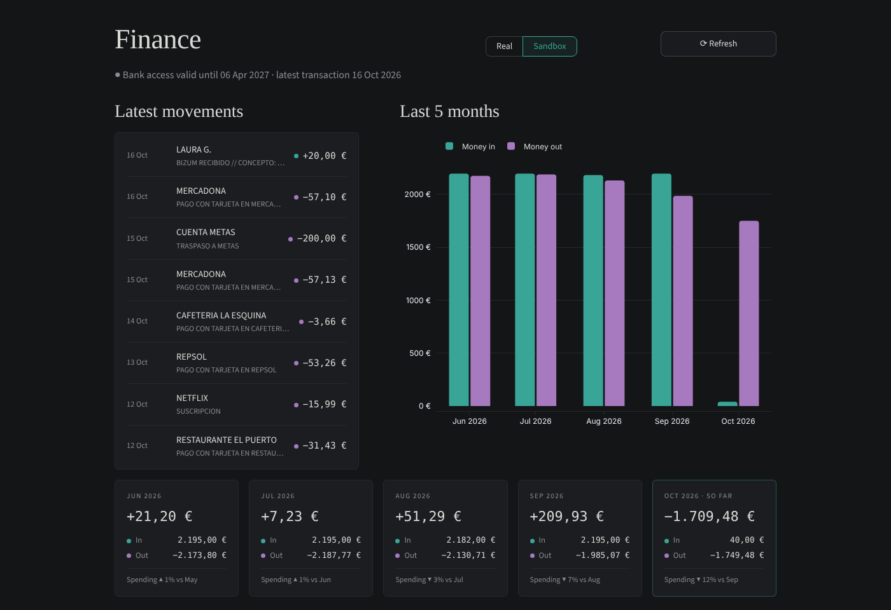

<div align="center">

# ◐ Finance App

**A private, local dashboard for your bank account.**
Syncs transactions through European Open Banking (PSD2), stores them on your own computer, and shows where your money goes — no subscriptions, no cloud.




<sub>Screenshot with invented demo data.</sub>

</div>

---

## ✨ Features

- [x] **Bank sync** with BBVA via [Enable Banking](https://enablebanking.com) (PSD2), up to ~5 years of history
- [x] **Incremental refresh** — only new transactions are downloaded; duplicates are impossible
- [x] **Latest movements** at a glance
- [x] **Month-by-month analysis** of the last 5 months, with a detailed view per month
- [x] **Full history explorer** with filters by period and account
- [x] **Real / Sandbox** switch to play with test data safely
- [ ] Automatic categories (Groceries, Rent, Salary…)
- [ ] Monthly budgets and savings goals
- [ ] Export to Excel / CSV

## 🧩 How it works

```
BBVA ──► Enable Banking API (PSD2) ──► Python + SQLite (your PC) ──► Streamlit dashboard
```

| Layer | Technology |
|---|---|
| Bank connection | Enable Banking API (PSD2) |
| Storage | SQLite + SQLModel — a single local file |
| Dashboard & charts | Streamlit + Plotly |

## 🔒 Privacy

Everything stays on your machine. Credentials (`.env`), private keys (`secrets/`) and bank data (`data/`) are git-ignored and blocked by a local pre-commit check — this repository only contains code.

## 🚀 Getting started

```powershell
py -m venv .venv
.venv\Scripts\Activate.ps1
pip install -r requirements.txt
copy .env.example .env               # then fill in your Enable Banking app IDs and key paths
python scripts\connect_bank.py       # log in to your bank and download your history
streamlit run dashboard.py           # open http://localhost:8501
```

Try it without a real bank: `python scripts\connect_bank.py sandbox` (test login `user1` / `1234` / OTP `012345`).

## 🎨 Design principles

- **Minimalist** — few elements, lots of space.
- **Dark & matte** — greys with one subtle accent; a quiet, *minimalist cyberpunk* feel.
- **Typography** — `Source Serif 4` for titles, `Inter` for text, `JetBrains Mono` for numbers.
- **Accessible colors** — teal = money in, violet = money out, checked for color blindness and always paired with labels.

---

<sub>Personal, non-commercial project · see <a href="PRIVACY.md">Privacy</a> and <a href="TERMS.md">Terms</a> · development log in <a href="MEMORY.md">MEMORY.md</a></sub>
